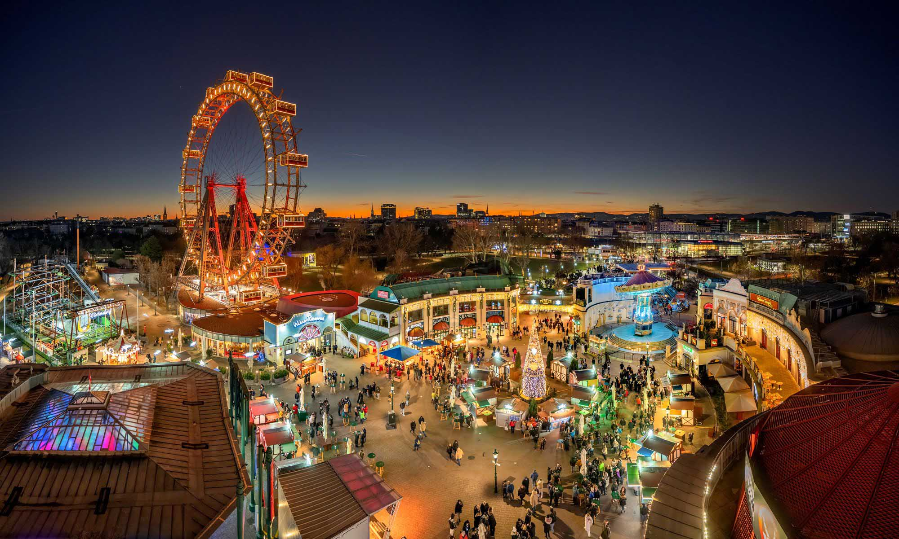

# Prater

Prater

In unserem Beitrag geht es um den Wiener Prater – einen besonderen Ort, an dem Natur, Freizeit und Unterhaltung aufeinandertreffen. Wir möchten den Leserinnen und Lesern die Vielfalt des Praters zeigen: von den bekannten Fahrgeschäften und dem Riesenrad bis hin zu den grünen Erholungsgebieten und versteckten Plätzen. Dabei zeigen wir, warum der Prater sowohl für Einheimische als auch für Besucherinnen und Besucher ein beliebtes Ausflugsziel ist und was ihn so einzigartig macht.

## Der Prater – Wiens berühmter Freizeit- und Erholungspark

Der Wiener Prater ist ein bekannter Freizeitpark und ein beliebtes Ausflugsziel in Wien. Besonders berühmt ist das Wiener Riesenrad, von dem aus man eine tolle Aussicht über die Stadt genießen kann. Im Prater gibt es viele spannende Fahrgeschäfte, wie Achterbahnen, Geisterbahnen und Autodroms. Neben den Attraktionen bietet der Prater auch große Grünflächen, auf denen man spazieren gehen, Rad fahren oder entspannen kann. Er verbindet Spaß, Abenteuer und Natur und ist deshalb ein beliebter Ort für Familien, Freunde und Touristen.

> [winterstimmung-c- ]

<!-- Erst aktivieren, wenn die Bilddatei vorhanden ist:

-->

*[Bildunterschrift sowie Bildquelle, Urheber und gegebenenfalls Lizenz]*

## [Eure nächste Zwischenüberschrift]

[Hier könnt ihr weitere Inhalte ergänzen.]

> **Bildplatzhalter 2:** Hier soll euer zweites Foto erscheinen.

*[Bildunterschrift sowie Bildquelle, Urheber und gegebenenfalls Lizenz]*

## Unser Tipp

[Was würdet ihr anderen für einen Besuch empfehlen?]

## Quellen

- [Titel eurer Quelle](https://example.org)

*Stand unserer Recherche: [Datum]*
<!-- für emojis Windowstaste + Punkt-->
